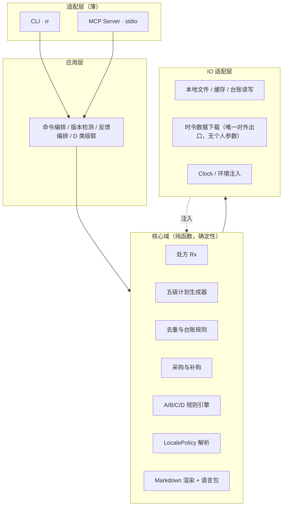

# plan.md · 技术方案（SDD · Plan 阶段）

> **项目**：recipe-recommender　|　**版本**：`v1.0.0`（基线）　|　**日期**：2026-11-06
> **状态**：✅ **已由用户审查通过并基线化**（2026-11-06，选方案 A 并授权 M2）　|　**上游**：[`SPEC.md`](SPEC.md) `v0.4.0-draft`、[`constitution.md`](constitution.md) `v1.0.0`、[`docs/decisions.md`](docs/decisions.md) ADR-002 / ADR-003、[`docs/competitive-research.md`](docs/competitive-research.md)
> **下游**：`tasks.md`（M2）→ 实现 + 测试 + 社区规范（M3/M4）→ Converge 报告（M5）

---

## 1. 输入、边界与目标

| 项 | 内容 |
|----|------|
| 输入约束 | FR-001～053、AC-01～19、NFR-001～015、SC-001～015、P-01～P-16（**不在此重复**） |
| 本文件回答 | 用什么技术、如何分层、目录与数据契约、接口长什么样、怎样测试与门禁、里程碑如何对应验收 |
| 本文件不回答 | 新增功能、修改验收标准、写实现代码、拆任务（`tasks.md`）、生成社区规范文件（M4） |
| 决策依据 | CL-02 已关闭：机械语言否决 → **ECMAScript / ISO/IEC 22275:2018**（ADR-002）；CL-11 已关闭（方案 A）：**维持单一主实现语言**，多语言落在语言包与可替换渲染器，第二实现语言须过 G-01～G-06 门禁（ADR-003）。本文件只把决策展开为可实施结构，不改写任何 FR / AC / SC |

> **P-04 边界**：本文件出现的所有模块名、命令名、字段名均为**接口契约**，不是实现；具体代码在 M3 产出。规格若需变更，必须先改 `SPEC.md`。

---

## 2. 技术选型

### 2.1 选定技术栈

| 层 | 选择 | 依据 / 对应约束 |
|----|------|-----------------|
| **实现语言** | **ECMAScript**，标准依据 **ISO/IEC 22275:2018**（ECMAScript® Specification Suite，现行）；语言特性遵循 **ECMA-262 现行版** | CL-02 / NFR-015 / P-16 / ADR-002 |
| **源码形态** | 纯 **ESM JavaScript**（`.js`，`"type": "module"`，UTF-8）；**无 `.ts` 实现源码** | TypeScript 无独立 ISO 编号；保证「实现语言」口径严格成立 |
| **运行时** | **Node.js 20 LTS 及以上**（Windows / macOS / Linux） | NFR-004；内置 `node:fs`、`node:path`、`node:test`、`node:assert`、`Intl` |
| **核心依赖** | **零运行时第三方依赖**（仅 Node 内置模块） | NFR-001 离线优先、NFR-008 供应链安全、FR-051 不依赖 LLM |
| **MCP 适配** | 官方 Tier 1 SDK `@modelcontextprotocol/sdk` + **stdio transport**；作为**可选安装**能力，许可在 M4 审计 | FR-030 / CL-01；ADR-002 §3.5 |
| **i18n** | 本地 `locales/<BCP47>/` 语言包（JSON 键值）+ `Intl`（ECMA-402）仅做日期 / 数字 / 单位格式化 | FR-040～044 / P-11；**运行期不调用在线翻译 / LLM**；开发期候选译文经人工审校入库（FR-041 补注 / ADR-003 §4.6）；中文输出满足 GB 18030-2022 级别 1（FR-043） |
| **测试** | `node:test` + `node:assert`，零第三方测试框架；AC 场景文件逐一可执行 | P-02 / FR-038 / NFR-005 |
| **静态检查** | JSDoc + `tsc --allowJs --checkJs --noEmit`（**可选开发期工具**）+ 严格 lint | 缓解纯 JS 无编译期类型；不改变实现语言 |
| **Markdown 渲染** | 自研纯函数渲染器（表格 + 头部元数据），无模板引擎依赖 | FR-006 / NFR-006 / 可 diff |
| **数据格式** | Profile / 语言包 / 缓存 = UTF-8 JSON；计划与台账 = 结构化 Markdown 表格 | FR-018 / FR-028 / Git 可 diff |
| **分发** | v1 仅 **GitHub Releases 源码归档 + 校验和** + Git 源码 | FR-052 / NFR-014 |

### 2.2 依赖与 `package.json` 的边界（易错点）

`package.json` 仅作为**本地开发期的 ESM 声明、脚本与开发依赖清单**，**不是发布清单**：

- 允许：`"type": "module"`、`scripts`（test / lint / acceptance / spec-check）、`devDependencies`、`engines`。
- 禁止：`publishConfig`、`files`（发布白名单）、供 `npm publish` 使用的 `bin` 字段、任何 `npm publish` / `yarn publish` / `pnpm publish` 工作流、`prepack` / `postpack` 发布钩子。
- Release 归档 = **源码 + 语言包 + LICENSE + THIRD_PARTY_NOTICES + 校验和 + 安装说明**；依赖由用户按锁文件本地安装，离线环境可 vendor 许可清晰的依赖（M4 审计）。
- 核心 CLI **不安装任何依赖也能跑**；`@modelcontextprotocol/sdk` 仅在用户启用 MCP Server 时安装。若其许可审计不通过，退化为自实现最小 stdio JSON-RPC 层（仍为纯 ECMAScript、零依赖），不影响任何 FR / AC。

### 2.3 平台与版本矩阵

| 维度 | 取值 |
|------|------|
| OS | `windows-latest` / `macos-latest` / `ubuntu-latest` |
| Node | `20` / `22` / `24`（LTS）；最低版本写入 `engines` 与 `CONTRIBUTING.md` |
| 编码 / 行尾 | UTF-8；`.gitattributes` 统一 LF（已落盘） |
| 时区 | 所有时间计算显式带时区；节气缓存统一 UTC+8 并按 LocalePolicy 换算 |

---

## 3. 架构分层



**依赖方向单向**：适配层 → 应用层 → 核心域 → IO 端口。核心域不直接调用 Node API，时间、文件、网络一律通过注入的 `clock` / `fs` / `net` 端口，以保证 AC 可确定性复现（AC-02 / AC-03 的固定运行日期、AC-04 的下载失败注入）。

**身体数据边界**：`Profile` 只在本地 IO 层与应用层之间传递；MCP 适配层**不得**接收或回传未脱敏身体数据（FR-030 / FR-048），工具返回值仅含计划文本与校验结论。

---

## 4. 目录结构

```
recipe-recommender/
├── SPEC.md / constitution.md / plan.md / tasks.md     SDD 工件
├── LICENSE / THIRD_PARTY_NOTICES.md / PRIVACY.md / SECURITY.md
├── README.md / CHANGELOG.md / CONTRIBUTING.md / CODE_OF_CONDUCT.md / SUPPORT.md
├── .github/                         Issue & PR 模板 / CODEOWNERS / workflows
├── package.json                     仅本地开发期清单（见 §2.2）
├── .gitignore / .gitattributes
├── src/
│   ├── core/                        核心域：纯函数、无 IO
│   │   ├── profile/                 档案解析、校验、版本号比对
│   │   ├── rx/                      处方推导（BMR 护栏 FR-002）
│   │   ├── guideline/               指南适配器（可插拔，FR-003）
│   │   ├── calendar/                历法适配器（solar-terms / gregorian-season，FR-011～013）
│   │   ├── locale/                  LocalePolicy 解析 + 回退链（FR-045/046）
│   │   ├── planner/                 year / season / month / week / day 生成器
│   │   ├── dedup/                   短期去重与周期性重复（FR-015～018）
│   │   ├── purchase/                周采购 + 日补购（FR-019/020）
│   │   ├── feedback/                A/B/C/D 规则引擎与时间线护栏（FR-022～027）
│   │   └── render/                  Markdown 渲染 + 语言包查表（FR-040～044）
│   ├── io/                          fs / cache / ledger / net / clock 端口实现
│   ├── cli/                         命令解析与输出格式化
│   └── mcp/                         MCP tools 注册与 stdio transport
├── locales/
│   ├── en/strings.json              完整基准键集（回退终点）
│   ├── zh-Hans/ fr/ de/ es/ ru/ la/strings.json
│   └── _schema/keys.json            Canonical ID 键集定义 + 完整性校验基准
├── data/
│   ├── guideline/                   指南指标（仅原则与量化值，不复制原文）
│   └── region/                      ISO 3166-1 区域 → 指南/历法/单位映射
├── tests/
│   ├── unit/                        核心域纯函数单测
│   ├── acceptance/                  AC-01～19 场景（先红后绿）
│   ├── fixtures/                    确定性 clock / fs / net 替身
│   └── snapshots/                   多语言快照、历史计划哈希基线
├── examples/profiles/               两份完全虚构档案（已落盘）
└── docs/                            竞品调研、决策记录、架构说明、用户文档
```

> `profiles/`（仓库根，存放**真实**个人档案）由 `.gitignore` 排除；`examples/profiles/` 中的虚构 fixtures 必须入库（此前修正过忽略规则，勿回填 `profiles/` 宽匹配）。

---

## 5. 数据契约

### 5.1 Profile（JSON，UTF-8）

与现有 `examples/profiles/*.json` 兼容 —— **fixtures 必须是合法的 Profile 最小实例**，可直接用于 `AC-01 / AC-15 / AC-16`。

| 字段 | 类型 | 说明 |
|------|------|------|
| `schema_version` | string | Profile schema 版本 |
| `fictional` / `notice` | bool / string | 仅示例档案必填；真实档案不含 `fictional: true` |
| `body` | object | `height_cm` `weight_kg` `bmi` `body_fat_pct` `water_pct` `bmr_kcal` `muscle_kg` `bone_kg` `protein_pct` `age_years` `sex` |
| `nutrition_rx` | object | 各项目标区间 + `floor_rule`（能量下限 ≥ `body.bmr_kcal`） |
| `goal` | object | 目标类型 + `note_key`（Canonical ID，不存自然语句） |
| `locale_policy` | object | `declared_nationality` / `declared_residence` / `guideline_override` / `calendar_override` / `output_language` / `expected_resolution` / `expected_source` |
| `privacy` | object | `storage: "local-only"`、`upload: false`、`telemetry: false`、`real_person_data` |
| `versions` | object | 四个数据版本 + 当前 `rule-` 版本（FR-001 / FR-009）；fixture 缺省时由引擎补 `fixture-*` 默认值并在输出标注 |

**校验规则**：缺 `bmr_kcal`、体脂越界、能量下限 < BMR、语言标签非法、地区码不在 ISO 3166-1 → 拒绝生成并给出可操作错误（E-08），不得用猜测值填充。

### 5.2 计划文件（Markdown）

每份计划头部 MUST 含：周期标识、生成日期、上承 / 下接文件、四个数据版本 + `rule-` 版本、最终生效的 LocalePolicy 及来源（`auto:nationality` / `auto:residence` / `user` / `auto:fallback`）、输出语言标签、免责声明与 `[AIGC]` 标注。正文为语言包渲染的表格；**所有数值由核心域计算，语言切换只替换字符串**（FR-044）。

### 5.3 缓存与台账

| 对象 | 位置 | 规则 |
|------|------|------|
| 时令缓存 | `data/calendar/solar-terms-YYYY.md`（或季节历对应文件） | 年计划时刷新，≥2 源交叉校验；下层只读；失败标 `FALLBACK / 未校验` |
| 去重台账 | 工作区 `history.md` | 只追加；登记日期 / 层级 / 周期标识 / 主菜与主食 Canonical ID / 所用版本 |
| 反馈台账 | 工作区 `feedback.md` | A/B/C/D 状态机；`待采纳 / 待接收 / 待对齐 → 已*` |
| 变更记录 | 工作区 `changelog.md` | `body-` / `rx-` / `loc-` / `st-` / `rule-` 五类版本 |
| 滚动速查 | `periodic-plan.md` / `weekly-plan.md` / `daily-plan.md` | 仅在指向未来周期时刷新（D 类时间线护栏） |

### 5.4 Canonical ID 与语言包

- 核心域、数据模型、去重指纹、台账**只处理 ASCII 稳定键**（如 `dish.radish_seabass_stew`），不得出现自然语句。
- `locales/<tag>/strings.json` 为纯键值；`locales/_schema/keys.json` 定义完整键集，CI 校验七个语言包键集 100% 一致（SC-011）。
- 回退链 `请求语言 → 基础标签 → 配置默认 → en`；缺失键显式标注，不静默混排（FR-042）。
- 拉丁语等缺现代术语时，语言包条目允许「规范译名 + 学名/原文」并列；**只影响显示，不改变营养数值或菜谱结构**（FR-043 / E-12）。

---

## 6. 接口契约（签名与命令，非实现代码）

### 6.1 核心域接口

| 接口 | 输入 → 输出 | 关联 |
|------|-------------|------|
| `loadProfile(path, fsPort)` | 路径 → `Profile` 或校验错误 | FR-001 |
| `computeRx(body, guidelineAdapter)` | 身体数据 + 指南 → `NutritionRx`（含 BMR 护栏） | FR-002 / FR-003 |
| `resolveLocalePolicy(profile, overrides)` | 档案 + 覆盖 → `LocalePolicy`（含来源标注） | FR-045 / FR-046 |
| `refreshCalendarData(year, calendarAdapter, netPort)` | 年份 + 适配器 → 缓存或 `FALLBACK` | FR-011～013 |
| `detectVersionChanges(profile, planHeader)` | 版本集合 → 重算指令 | FR-004 / FR-005 |
| `planYear / planSeason / planMonth / planWeek / planDay(ctx)` | 上下文 → 结构化计划对象（未渲染） | FR-006～010 |
| `applyDedup(candidate, ledger, window)` | 候选 + 台账 → 通过 / 替换建议 + 原因 | FR-015～018 |
| `buildPurchasePlan(weekPlan, remainingWindow)` | 周计划 + 剩余窗口 → 两栏采购计划 | FR-019 / FR-020 |
| `classifyFeedback(issue, timeline)` | 问题 + 时间线 → A / B / C / D1 / D2 动作 | FR-022～027 |
| `render(planObject, languagePack, intlFormatter)` | 计划对象 + 语言包 → UTF-8 Markdown | FR-040～044 |

### 6.2 CLI（可执行名 `rr`）

| 命令 | 关键参数 | 产出 / 关联 |
|------|----------|-------------|
| `rr init` | `--profile <path>` | 初始化本地工作区与台账；不写入任何真实身体数据到仓库 |
| `rr plan` | `--level year\|season\|month\|week\|day --date <ISO> --lang --guideline --calendar --country --profile` | 生成对应层级计划；CLI 参数即 FR-046 的用户覆盖入口 |
| `rr validate` | `--level --date --strict` | 校验计划与处方一致性、版本、去重、护栏（FR-002 / FR-027） |
| `rr ledger` | `--type dedup\|feedback\|changelog --last <n>` | 查询台账（只追加，不回改） |
| `rr feedback` | `--id --status --note` | 反馈状态流转（M2 细化） |
| `rr acceptance` | `--ac AC-01..AC-19 --red-check` | 执行验收场景，输出红/绿（P-02 / AC-14） |
| `rr locales` | `--verify` | 校验语言包键集完整性（SC-011） |
| `rr export-data` | `--out <path>` | 导出全部本地数据为可读格式（FR-049） |
| `rr delete-data` | `--confirm` | 删除本地数据并校验无残留（FR-049） |
| `rr serve-mcp` | 无（stdio） | 启动 MCP Server（FR-030） |

> 环境变量与配置文件也可提供 `--lang` / `--country` 等覆盖；优先级 `CLI > 环境变量 > 配置文件 > 自动解析`（FR-046）。

### 6.3 MCP tools（`rr_` 前缀）

| Tool | 输入（不含身体数据） | 输出 |
|------|---------------------|------|
| `rr_generate_plan` | `level`, `date`, `profile_ref`（本地引用 ID）, `lang`, `guideline`, `calendar` | 计划 Markdown + 校验结论 |
| `rr_validate_plan` | `plan_ref`, `level` | 一致性结论 + 违规项 Canonical ID |
| `rr_query_ledger` | `type`, `last` | 台账摘要（脱敏） |
| `rr_list_locales` | 无 | 支持的语言标签列表 |

**硬约束**：stdio 本地传输、不监听网络端口、不向客户端回传任何身体数据（FR-030 / FR-048）；工具描述与错误信息同样不得含个人数值。

---

## 7. 关键流程

### 7.1 年计划（1/1，唯一需联网的常规路径）


### 7.2 周计划与日计划

- **周（周一 08:00）**：确定本周 ISO 周 → 按缓存判节气 → 生成 7 天食谱 → **两栏采购计划**（全周理论用量 / 剩余窗口实际补购量）→ 去重（7 天内互不重复、近 4 周 ≤2 道）→ 上级反馈检查 + D 类接收 → 刷新 `weekly-plan.md`。
- **日（每日 20:00）**：目标日期 = 运行日 + 1 → 优先取当周该日菜单 → 最近 7 天去重替换（**去重优先于周计划与非安全类下发修订**）→ 补购缺口 / 前夜备餐 → 营养对照与饮水提醒 → 刷新 `daily-plan.md`。
- **D 类接收**：周 / 日任务生成前先读反馈台账 `待接收` / `待对齐`；涉及已执行日期一律 `已跳过(已执行)`，不回改历史（P-05 / AC-11）。

### 7.3 重算与修订的公共切分

所有「体测 / 搬家 / 年计划修订」触发的流程，第一步都是按 `计划日期 ≤ 运行日` 切分：**已执行部分只读**，仅对未来部分做 D1 即时修订或 D2 提示，并写「上级下发修订标注」+ `rule-` 版本（FR-024 / AC-06 / AC-11）。

---

## 8. i18n 与区域策略实现路径

| 步骤 | 实现要点 | 验收 |
|------|----------|------|
| 1 | `LocalePolicy` 由用户**自声明**的 `declared_nationality` → `declared_residence` 解析；映射表基于 ISO 3166-1 地区码 | AC-16 |
| 2 | 用户覆盖（CLI / 配置 / 环境变量 / MCP 参数）优先于自动解析；结果写入计划头部来源字段 | AC-16 / SC-012 |
| 3 | 无匹配 → 中立通用指南 + `gregorian-season` + 显式「未匹配，已回退」 | AC-16 / E-14 |
| 4 | 指南 / 历法适配器可插拔；`solar-terms` 走精确交节下载，`gregorian-season` 走季节划分，同等遵守「年刷新 / 下层只读 / FALLBACK」 | FR-011～013 注 / AC-04 |
| 5 | 语言包按 BCP 47 加载；七语言键集一致性由 `rr locales --verify` 保证 | AC-15 / SC-011 |
| 6 | 输出只用一种请求语言；回退键单独标注；切换语言后营养数值、去重指纹、台账哈希不变 | FR-044 / AC-15 |

> **地区表述合规**：中国香港 / 中国澳门 / 中国台湾作为地区级选项，不得列为独立国家；实现中不得通过 IP / 定位 / 静默推断获取国籍或位置。

---

## 9. 隐私、安全与合规实现

| 控制点 | 方案 |
|--------|------|
| 数据位置 | 真实档案仅在工作区本地目录，`.gitignore` 排除根目录 `profiles/`；示例与 fixtures 全为虚构 |
| 网络出口 | 核心链路零网络；唯一出口是 `netPort` 的时令数据下载，**请求不含任何个人参数**，且可被测试注入为离线 / 失败（FR-048 / AC-17） |
| 日志与异常 | 统一日志适配器，默认只记录 Canonical ID 与错误码，禁止输出身体数值；CI fixtures 与 Release 归档执行令牌扫描 |
| 数据主体权利 | `rr export-data` / `rr delete-data`；删除后校验缓存、台账、日志无残留（FR-049） |
| LLM 增强 | 默认关闭；启用需逐次显式同意并明确范围；不可用时自动降级为规则 / 模板引擎（FR-051 / AC-17） |
| 未成年人 | README / PRIVACY 明确提示；默认不采集敏感个人信息 |
| 合规文档 | `PRIVACY.md` / `SECURITY.md`（M4）声明 PIPL / 数据安全法 / 网络安全法 / GDPR 等适用法与存放位置 |
| 许可 | `LICENSE`（GPL-3.0 全文已落盘）+ `THIRD_PARTY_NOTICES.md`（M4）；SDK 许可存疑则不引入，退化为零依赖 stdio 层 |

**Corresponding Source**：Release 归档必须包含全部实现源码、语言包、构建与测试脚本，使接收者可自行修改并重建；产物与源码一一对应（P-16 / AC-19 / SC-015）。

---

## 10. ATDD 测试策略与 AC 映射

| 测试族 | 覆盖 | 手段 |
|--------|------|------|
| 单元 | 处方推导、版本检测、去重指纹、LocalePolicy、语言包回退、采购折算、反馈分类 | `node:test` 纯函数，注入 clock / fs 替身 |
| 验收 | **AC-01～19** 逐一对应 `tests/acceptance/ac-01.md` … `ac-19.md` + 可执行驱动 | 实现前全部为红；实现后转绿（P-02） |
| 快照 | 七语言输出、历史计划哈希基线、Markdown 头部元数据 | `tests/snapshots/` |
| 离线 | 断网 + LLM 关闭 + 网络端口禁用 | 运行时断言「零对外请求」 |
| 合规扫描 | 真实身体数据令牌、`diet-plan` 数据、包管理器发布配置、许可冲突、规格编号连续性 | CI 静态脚本 |
| 矩阵 | OS × Node（§2.3），同一组 AC 结果一致 | CI matrix |

**关键确定性手段**：`clock` 注入固定运行日期（AC-02 的 2026-01-01、AC-03 的 2026-11-06 20:00、AC-09 的周五补跑）、`netPort` 注入下载成功 / 失败 / 双源冲突、`fsPort` 注入临时工作区与历史文件哈希基线。

**AC-19（本轮新增）**：校验实现源码语言形态、无机器码交付、Corresponding Source 齐备、三平台 AC 结果一致。

---

## 11. CI 门禁

| Job | 内容 | 对应原则 |
|-----|------|----------|
| `spec-consistency` | FR / AC / SC / NFR / P 编号连续、追溯矩阵无孤儿、`[NEEDS CLARIFICATION]` = 0 | P-01, P-03, P-04, P-09 |
| `lint-typecheck` | lint + `tsc --checkJs --noEmit` + 语言包键集一致性 | P-11, NFR-008 |
| `unit` | 核心域单测 + 覆盖率 ≥ 80% | P-02, SC-002 |
| `acceptance` | AC-01～19 全绿、红→绿记录 | P-02 |
| `privacy-scan` | 真实数据 / diet-plan / 网络出口 / 日志脱敏静态扫描 | P-06, P-14, P-15 |
| `license-scan` | GPL-3.0 + THIRD_PARTY_NOTICES + Corresponding Source | P-07, P-16 |
| `community-files` | `SPEC.md §10` 必需文件存在且非空 | P-09, FR-036 |
| `matrix` | 三 OS × 三 Node 版本跑同一组 AC | NFR-004, SC-015 |
| `polyglot-gate` | 第二实现语言准入 G-01～G-06（**默认关闭**，v1 恒为拒绝；仅登记不执行） | P-16, NFR-015, A-10, E-18, ADR-003 §4.4 |
| `encoding-check` | 中文输出汉字在 GB 18030-2022 实现级别 1 覆盖范围内 | FR-043, AC-15 |

> 门禁从 M3 起逐步启用；M0′ 已运行的「真实身体数据令牌扫描」纳入 `privacy-scan`。`polyglot-gate` 为预留门禁（G-06 默认拒绝），M4 起仅登记检查结果，不引入任何第二实现语言工具链。

---

## 12. 里程碑与交付映射

| M | 交付 | 出口条件（引用，不重写） |
|---|------|--------------------------|
| **M0′ / M0** ✅ | Git 立项、`SPEC.md v0.4.0-draft`、ADR-002 / ADR-003、澄清全关闭 | 已完成，2026-11-06 |
| **M1** ✅ 已审查通过 | `constitution.md`、`plan.md`（本文件） | 用户审查通过并选方案 A（P-09 / P-10，2026-11-06） |
| **M2** ✅ 已产出 | `tasks.md`：有序任务，每条关联 FR / AC / SC，标注依赖、并行与红→绿顺序 | M1 审查通过；无实现代码 |
| **M3** 🟡 已开工 | P0 骨架（T-001 `package.json` + `src/` 目录）已落盘；后续核心域 + CLI + P1 用户故事实现 + AC-01～12 转绿 | US-01～05 对应 FR 通过、CI 绿 |
| **M4** ⏸ | MCP Server、i18n 七语言、区域策略、社区规范全套、PRIVACY / SECURITY / THIRD_PARTY_NOTICES | 全部 FR 通过、AC-13～19 转绿、§10 必需文件齐备 |
| **M5** ⏸ | Converge 报告 + Release 归档 + 校验和 | SC-001～SC-015 全部达成、追溯矩阵核验通过 |

---

## 13. 风险与开放项

| # | 风险 / 开放项 | 处理 |
|---|---------------|------|
| R-01 | **CL-07 正式仓库名 / 归属账号未定** | 发布前确认；不阻塞 M1～M4，影响 README 徽章、CITATION.cff、release workflow |
| R-02 | ISO/IEC 22275:2018 若被撤销或运行时生态变化 | 按 E-17 / ADR-002 §3.7 切换另一现行 ISO 标准语言，**只重做本文件与 constitution（如涉及），不改 FR / AC / SC** |
| R-03 | `@modelcontextprotocol/sdk` 许可审计不通过 | 退化为自实现零依赖 stdio JSON-RPC 层（§2.2） |
| R-04 | HowToCook(Unlicense) / USDA FDC(CC0) 与「人工校验中国食材子集」的版权与准确性 | M4 前完成逐项审计；存疑数据一律不内置，降级为用户自建适配器（A-02 / FR-031） |
| R-05 | 用户需预装 Node 20+ 而 v1 不发包管理器 | README 安装说明 + Release 附源码与校验和；核心 CLI 零依赖可用（SC-009 ≤3 步） |
| R-06 | 七语言（含拉丁语）术语质量 | 语言包由人工审校，缺失术语「译名 + 学名/原文」并列；不因翻译改变数值（FR-043） |
| R-07 | 时区 / 交节当日归属等边界 | 沿用 E-01 / E-02 与 `_feedback.md` 待采纳提案，由上级周期任务裁定 |
| R-08 | AI 生成物的基线化 | 所有 `[AIGC]` 工件（含本文件）须用户人工审查后方可作为基线（P-10）；M1 工件已于 2026-11-06 基线化 |
| R-09 | 未来被要求引入第二实现语言 / 使用无现行 ISO 或 GB 标准的语言 | 按 ADR-003 G-01～G-06 门禁处理，默认拒绝并维持单语言；通过后新增 ADR 并重做本文件，不改 FR / AC / SC（A-10 / E-18） |

---

## 14. 本阶段明确不做

- ❌ 不写任何 `src/` 实现代码、不写测试实现、不写语言包内容（M3/M4）。
- ❌ 不生成 `SPEC.md §10` 的社区规范文件（M4）；`tasks.md` 已由 **M2** 单独产出，不属于 Plan 工件。
- ❌ 不创建 GitHub 远程仓库、不推送、不发布 Release、不运行 `npm publish`。
- ❌ 不把 `../diet-plan/` 的任何真实数据带入本仓库。
- ❌ 不因技术选型改动任何 FR / AC / SC 的业务语义。

---

> [AIGC] 本方案由 AI 依据 `SPEC.md v0.4.0-draft`、ADR-002 / ADR-003 与 2026-11-06 联网核实的标准状态生成，**已由用户 2026-11-06 审查通过并基线化**（P-10） · 审计追踪 ID：`RR-PLAN-20261106-0001`
